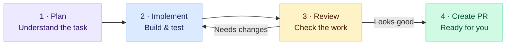

<div align="center">

# Gantry

### Big ideas. Less babysitting.

**Turn a ticket into working software—with your favourite coding agents.**

Describe the idea. Your agents plan, build, review, and open the PR—all in one desktop app.

[**Get started ↓**](#get-started) · [Explore the docs](docs/FAQ.md) · [Give feedback](https://github.com/Drajax69/gantry/issues)

**Claude Code · Codex · OpenCode**<br>
Open source · macOS & Windows · MIT licensed

</div>

## Your idea. A team of agents. One graph.



**This graph comes ready to run.** Every stage has a built-in prompt. Review sends fixes back to implementation; approved work becomes a PR.

Drag stages around. Connect your own steps. Pick a different agent or model for each one—or just use the defaults.

<picture>
  <source media="(prefers-color-scheme: dark)" srcset="docs/images/ticket-board-dark.png">
  <source media="(prefers-color-scheme: light)" srcset="docs/images/ticket-board-light.png">
  
</picture>

<p align="center"><sub>Your next idea, its agent, and everything it needs. Together.</sub></p>

## You bring the ideas. Gantry keeps things moving.

| | |
| --- | --- |
| **Start with a ticket.** | Describe what you want. Drag it into **In progress**. Your agent gets to work. |
| **Build your dream team.** | A ready-made graph handles planning, implementation, review, and the PR. Customize any stage. |
| **See it working.** | Open a running preview of your feature, right beside your tickets. |
| **Keep the whole feature together.** | Chats, changes, and pull requests stay with the ticket—even across repositories. |

## Get started

### 1. Grab the essentials

Install [Node.js 22.12+](https://nodejs.org/), [Git](https://git-scm.com/), and [herdr](https://herdr.dev) for agent chats.

Choose and sign in to one coding agent: [Claude Code](https://docs.anthropic.com/en/docs/claude-code), [Codex](https://developers.openai.com/codex/cli), or [OpenCode](https://opencode.ai).

For GitHub reviews, install [GitHub CLI](https://cli.github.com/) and run `gh auth login`.

### 2. Build and open Gantry

Paste these commands into your terminal:

```sh
git clone https://github.com/Drajax69/gantry.git
cd gantry
npm ci
npm run desktop:setup
npm run desktop:start
```

### 3. Give it something to build

Open your project in your coding agent and paste:

> Set up Gantry for this folder using https://github.com/Drajax69/gantry/blob/main/SETUP.md

Your agent configures the workspace, previews, and starter graph for you.

Choose your agent in **Settings** → **Add workspace** → create a ticket → drag it into **In progress**.

New workspaces start the graph automatically when a ticket enters **In progress**. Keep Gantry open and follow each stage in **Workspace graph**. No graph-building required.

<details>
<summary><strong>Want a standalone app?</strong></summary>

After the setup above, run this on the computer you'll use:

```sh
npm run desktop:build
```

You'll find the app in `desktop/dist/`. On Apple Silicon Macs, open `desktop/dist/mac-arm64/Gantry.app`.

For a Windows installer, then run:

```sh
npm run app:build:win --prefix desktop
```

Windows needs PowerShell. Builds are currently unsigned.

</details>

---

<div align="center">

**Build something you've been putting off.**

If Gantry helps you ship it, [give it a star](https://github.com/Drajax69/gantry). It helps the next builder find us.

[Configuration](docs/configuration.md) · [FAQ](docs/FAQ.md) · [Contribute](CONTRIBUTING.md) · [Privacy & security](docs/security.md) · [MIT license](LICENSE)

</div>
