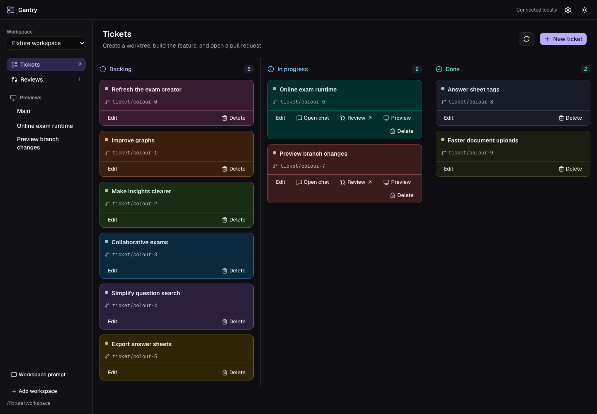

<div align="center">

# Gantry

### From “I should build that” to a pull request.

A local desktop workspace for your tickets, coding agents, branch previews, and code reviews.

**One ticket. Its own worktrees. Its own conversation. Every related PR.**

[Get started](#get-started) · [How it works](#from-ticket-to-pull-request) · [Configure your workspace](docs/configuration.md) · [Contribute](CONTRIBUTING.md)

[](LICENSE)
[](#get-started)
[](#your-workspace-on-your-machine)

</div>

<picture>
  <source media="(prefers-color-scheme: dark)" srcset="docs/images/ticket-board-dark.png">
  <source media="(prefers-color-scheme: light)" srcset="docs/images/ticket-board-light.png">
  
</picture>

<p align="center"><sub>The real Gantry app, shown with demo tickets. Light and dark themes included.</sub></p>

## Keep the whole feature in view

Working with coding agents quickly turns into a coordination problem. Which chat belongs to this branch? Where is its preview? Did that change make it into the PR? What happens when one feature spans three repositories?

Gantry keeps those pieces attached to the ticket. Move an idea into progress, work with your agent, try the running feature, and review the changes—all with the same workspace close at hand.

| | What you get |
| --- | --- |
| **A board that starts the work** | Drag a new ticket into **In progress** to prepare its worktrees, open its coding conversation, and automatically send the starting prompt. |
| **Your agent, with the context ready** | Use Codex in its app or Claude Code in Terminal. Ticket details, workspace instructions, and checkout paths go with the conversation. |
| **A place for every PR in a feature** | Related PRs share a ticket review space, including work spread across multiple repositories. |
| **The feature running beside the board** | Open Main and active ticket previews inside Gantry. Switch services without hunting for ports. |
| **Debugging where you are testing** | Open the Debug panel for console output, network requests and responses, XHR filtering, and per-service logs. |
| **A clear path from edits to GitHub** | Review published PR changes and local edits separately. Ask the review agent to make changes, inspect them, then commit and push from the app. |

## From ticket to pull request

**1. Describe the feature.**

Create a ticket with a title and details. Give the workspace a reusable starting prompt: how to work in the codebase, what to validate, and what delivery should look like.

**2. Drag it into progress.**

Gantry prepares the ticket's Git worktrees and starts its external coding conversation with that context. A new chat's prompt is submitted automatically. Reopening the chat returns to the same conversation without resending it.

**3. Build with your agent.**

Keep using Codex or Claude Code directly. Ask it to implement the feature, run checks, and create a draft PR. Each ticket retains its chosen provider and conversation, even if you change the default later.

**4. Try what changed.**

With preview services configured, open the ticket's running app from the sidebar. Keep Main nearby for comparison. Inspect console messages, request bodies, responses, and service logs in the Debug panel.

**5. Review and publish.**

Gantry discovers PRs matching the ticket's branch and brings them into its review space. Review the diff, make further edits with the review agent, and use **Commit and push** when the local changes are ready.

**6. Clear the board.**

Move the ticket to Done. Its preview and review entries leave the active sidebar, while the ticket retains its history.

> **Already have the branch and PRs?** Create a ticket using that exact branch name. Gantry's remote sync discovers the associated PRs so existing work can join the board too.

## Get started

The desktop app currently targets **macOS** and is built from source. You'll need:

- **Node.js 22.12+**, npm, and Git.
- **GitHub CLI**, authenticated with `gh auth login`, for the GitHub review workflow.
- **Codex or Claude Code**, installed and signed in, to start ticket conversations.

```sh
git clone https://github.com/Drajax69/gantry.git
cd gantry
npm ci
npm run desktop:setup
npm run desktop:start
```

Once Gantry opens:

1. Pick your provider in **Settings**.
2. Select **Add workspace** and choose a repository or a folder containing repositories.
3. Set the **Workspace prompt** to describe how your agent should work.
4. Create a ticket and drag it into **In progress**.

Gantry discovers repositories and creates a local `gantry.yaml` if you don't have one. You can start with tickets and coding conversations, then add preview services when you're ready.

<details>
<summary><strong>Build a standalone Gantry.app</strong></summary>

```sh
npm run desktop:build
open desktop/dist/mac-arm64/Gantry.app
```

The output directory depends on your Mac's architecture. Builds are currently unsigned; there is no signed installer. The runtime also runs on Linux, but desktop packaging is configured for macOS. Windows service supervision is not currently supported.

</details>

### Choose your coding workflow

Configure the default provider once in Settings. Ticket conversations remember their provider; PR review uses the shared provider configuration.

| Provider | Ticket conversations | In-app PR review chat |
| --- | --- | --- |
| **Codex** | Opens in the Codex app on macOS | Supported |
| **Claude Code** | Opens in Terminal | Supported |
| **OpenAI-compatible API** | Requires Codex or Claude instead | Supported, including OpenRouter and compatible local endpoints |

Gantry manages the handoff to your external coding app. The review chat stays beside the diff so you can discuss and edit the code you are reviewing.

## Your repositories. Your stack.

A workspace can contain one Git repository or several. A ticket can bring the matching worktrees and PRs together across them.

`gantry.yaml` describes your repositories and how to run your preview services. Use ordinary commands for your stack, or the managed Vite, Node, and Python runners. Configure service dependencies, health checks, environment-file paths, and ports in one place.

For example, a Vite frontend can depend on its backend and receive the backend's allocated port:

```yaml
# A service entry inside your workspace's gantry.yaml.
# Assumes repositories.frontend and a service named backend are declared.
services:
  - id: frontend
    repository: frontend
    runtime: command
    install: npm ci
    start: npm run dev -- --host 127.0.0.1 --port ${port}
    dependsOn: [backend]
    env:
      VITE_BACKEND_URL: http://127.0.0.1:${port.backend}
    healthUrl: http://127.0.0.1:${port}/
    openUrl: http://127.0.0.1:${port}/
```

Your frontend must read that environment variable. Gantry supplies the value; your application decides how to use it.

See the [complete example workspace](examples/minimal/gantry.yaml) and [configuration reference](docs/configuration.md) for all options. A configuration containing only shareable commands and paths can live in your own repository; keep credentials in private environment files.

## Your workspace, on your machine

Gantry's board, workspace state, worktrees, and logs live locally. Connecting a workspace does not upload its tickets or configuration to this public repository.

Your selected coding provider receives the prompts and code needed for its work, and GitHub operations use your existing `gh` authentication. Local storage does not make a cloud model local.

A few practical boundaries:

- Preview **processes and ports** are separated per branch. Databases are only separate if you configure separate databases.
- Provider credentials are stored in permission-restricted local files, not the OS keychain.
- Agents work with local tools and credentials. Use trusted repositories and review changes before publishing. API-provider command execution is not an OS sandbox.
- **Commit and push** publishes to the PR's source branch without force-pushing. If a push fails, the local commit remains available for retry.

<details>
<summary><strong>Where Gantry stores its data</strong></summary>

| Data | Location |
| --- | --- |
| Runtime state on macOS | `~/Library/Application Support/gantry` |
| Runtime state on Linux | `$XDG_DATA_HOME/gantry` or `~/.local/share/gantry` |
| Provider settings, review spaces, and conversation associations | `~/.pr-lens` |
| Desktop profile | The `PR Lens` application-support directory |
| Ticket worktrees | The worktree directory configured for your workspace |

`GANTRY_DATA_DIR` and `PR_LENS_HOME` override the corresponding locations. The legacy `PR Lens` names preserve compatibility with earlier installations.

</details>

Read more about [security and execution boundaries](docs/security.md) or browse the [FAQ](docs/FAQ.md).

## Build Gantry with us

Gantry is **open source under the MIT license**. Try it on a real workflow, tell us where you lose context, or help make that handoff better.

- [Report a bug or propose a feature](https://github.com/Drajax69/gantry/issues).
- Read the [contributing guide](CONTRIBUTING.md) and [architecture overview](docs/architecture.md).
- If Gantry fits the way you work, star the repository to help other developers find it.

<details>
<summary><strong>Development layout and checks</strong></summary>

| Directory | Purpose |
| --- | --- |
| `desktop/` | Electron + Next.js app, ticket board, previews, provider settings, and PR review |
| `packages/server/` | Local runtime, tickets, worktrees, service supervision, and GitHub discovery |
| `packages/shared/` | Configuration schema and shared models |
| `packages/cli/` | Gantry CLI |
| `packages/ui/` | Standalone browser dashboard for runtime administration |

After installing the root and desktop dependencies:

```sh
npm run typecheck
npm run lint
npm test
npm run build
npm run typecheck --prefix desktop
npm run lint --prefix desktop
npx --prefix desktop playwright install chromium
npm run desktop:test
```

Browser tests use fake providers and disposable Git repositories. They do not publish real PRs.

</details>
